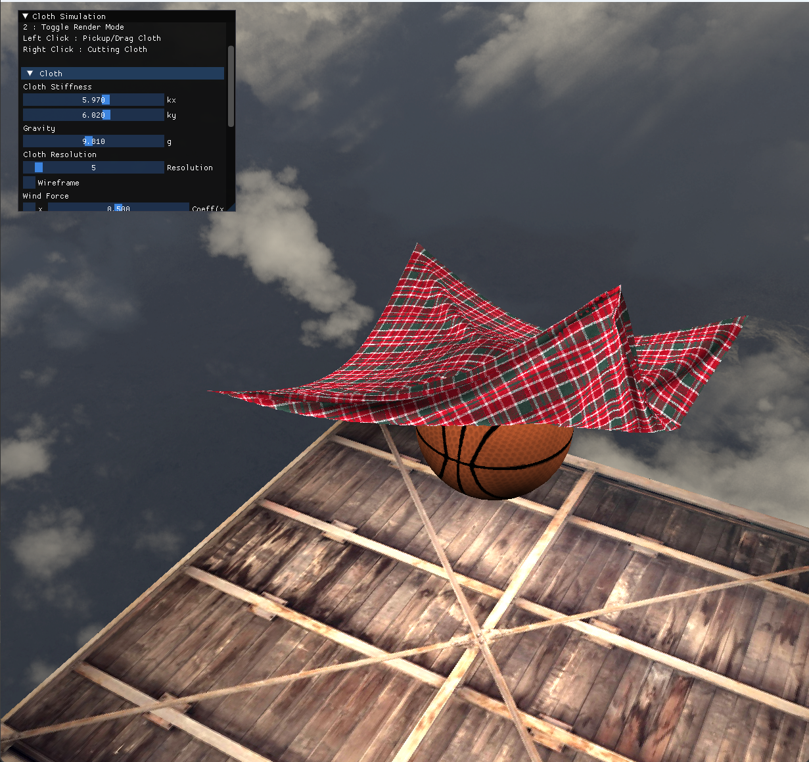
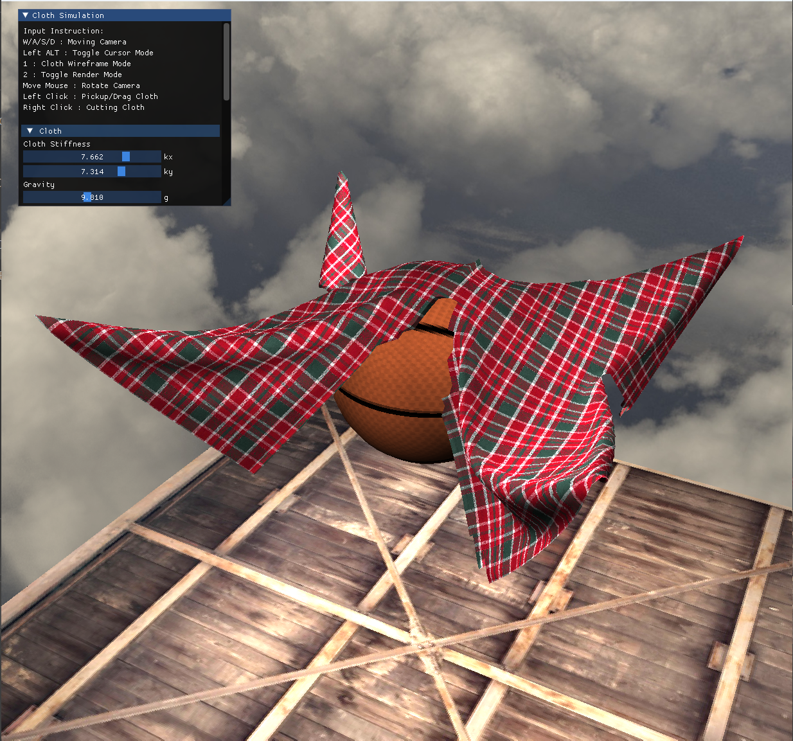
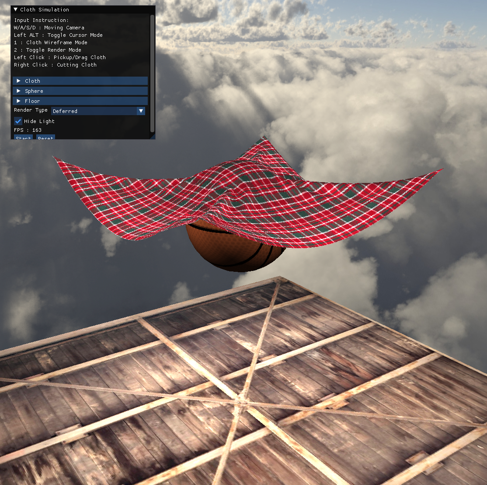

# PointMassSpring_Cloth

An interactive **cloth simulation** built with **C++ / OpenGL 4.6**.
The cloth is modeled as a grid of point masses connected by **structural, shear, and flexion springs**, integrated with the **Runge–Kutta 4th order (RK4)** method. It can be dragged and cut with the mouse (**BVH-accelerated raycasting**), blown by wind, and collides with a movable sphere and the floor. The scene is rendered through a **deferred shading** pipeline, and all simulation parameters can be tweaked in real time through a **Dear ImGui** panel.







## Features

- Mass–spring cloth model with three spring types: structural, shear, and flexion (bending)
- **RK4 integration** for point mass dynamics, with fixed timestep + substeps for stability
- Mouse interaction via **BVH raycasting** ([madmann91/bvh](https://github.com/madmann91/bvh)):
  - **Pickup mode** — grab and drag any point mass
  - **Cut mode** — tear the cloth by dragging across it (`Tab` or UI radio button to switch)
- Collision detection & response against a movable sphere and the floor
- Real-time parameter tuning via ImGui:
  - **kx / ky** — cloth stiffness
  - **g** — gravity
  - **Resolution** — cloth grid resolution
  - **Wind Force** — per-axis (X/Y/Z) toggle + coefficient
  - **Pin Point** — pin/unpin each of the four cloth corners
  - Sphere / floor position and colors
- **Deferred shading** pipeline (position / normal / albedo-spec G-Buffer) with 5 point lights
- Wireframe toggle, skybox (cubemap), multithreaded update with OpenMP

## Controls

| Input | Action |
| --- | --- |
| Hold `Right Mouse Button` | Enter camera mode (editor-style — the camera only moves while held) |
| Mouse (while holding RMB) | Rotate camera |
| `W` / `A` / `S` / `D` (while holding RMB) | Move forward / left / backward / right |
| `E` / `Q` (while holding RMB) | Move up / down |
| `Left Mouse Button` (drag) | Pickup/Drag or Cut cloth, depending on the current mode |
| `TAB` | Toggle Pickup / Cut mode |
| `SPACE` | Start simulation |
| `1` | Toggle wireframe mode |
| `2` | Cycle render mode (Deferred / Diffuse / Position / Normal) |
| `Z` / `X` | Move sphere along −Z / +Z |
| `C` / `V` | Move sphere along −Y / +Y |
| `ESC` | Quit |

## Building

Requirements:

- Visual Studio 2019/2022
- A GPU + driver supporting **OpenGL 4.6**

Open `PointMassSpring_Cloth.sln` with Visual Studio and build. Run with the working directory set to the project root so the `Shader/` and `Texture/` folders can be found — this is the default when launching from Visual Studio.

## Dependencies

All dependencies are vendored in [`External Libraries/`](External%20Libraries):

| Library | Purpose | How it is obtained |
| --- | --- | --- |
| [GLFW](https://www.glfw.org/) | Window / input / OpenGL context | prebuilt `glfw3.lib` (vendored) |
| [GLAD](https://glad.dav1d.de/) | OpenGL function loader | vendored |
| [glm](https://github.com/g-truc/glm) | Math library | vendored |
| [Dear ImGui](https://github.com/ocornut/imgui) | UI panel | vendored |
| [stb_image](https://github.com/nothings/stb) | Texture loading | vendored |
| [bvh](https://github.com/madmann91/bvh) | BVH raycasting for mouse picking | vendored |

## Project structure

```
├── src/                  # Application code (cloth, point mass, camera, input, window)
│   └── Renderer/         # Thin OpenGL wrappers (shader, mesh, VAO/VBO/EBO, texture, skybox)
├── Shader/               # GLSL shaders (gBuffer, deferred, lightBox, skybox, object)
├── Texture/              # Cloth texture + skybox cubemap
├── LaTex/                # Write-up of the cloth cutting method (PDF)
└── External Libraries/   # Vendored third-party libraries
```

## Documentation

A detailed write-up of the cloth **cutting method** is available at [`LaTex/PointMassSpring_Cloth_CuttingMethod.pdf`](LaTex/PointMassSpring_Cloth_CuttingMethod.pdf).

## License

[MIT](LICENSE)
